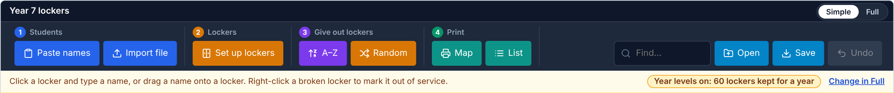
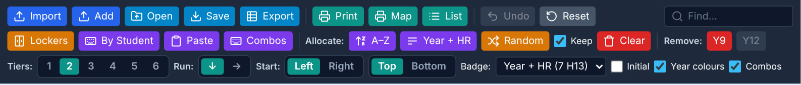
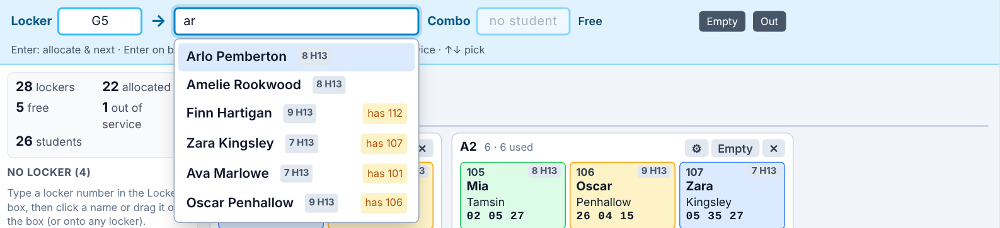
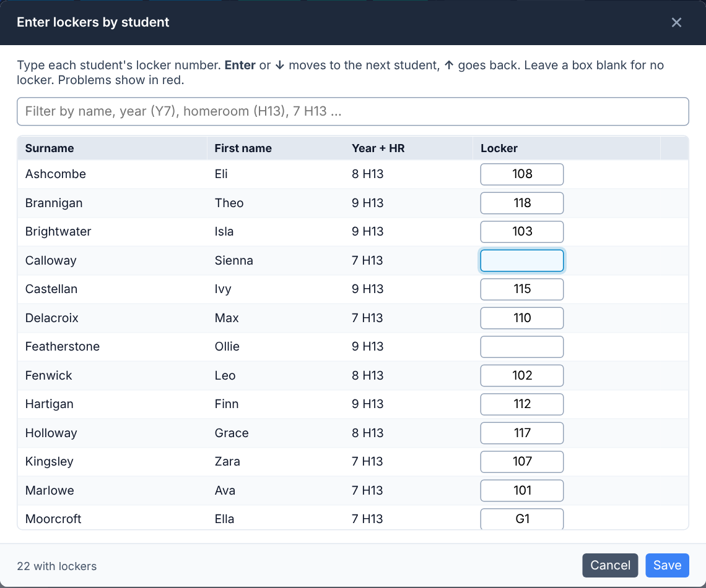
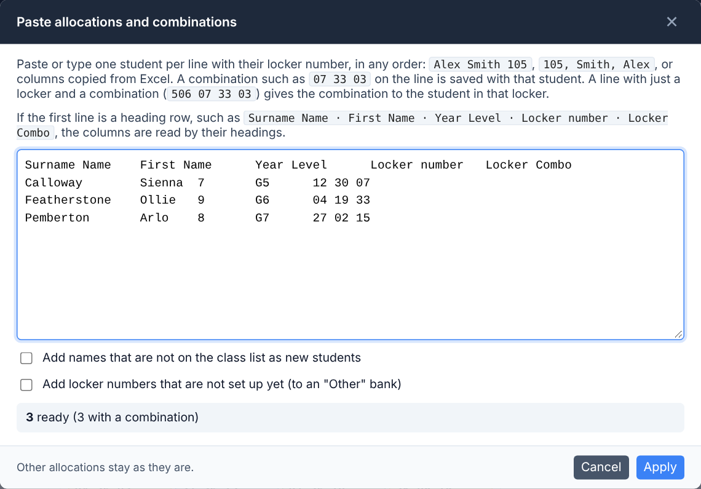

============================
Locker Allocation user guide
============================

The locker tool keeps track of which student has which locker. You set up the
locker numbers once, load a class list, then allocate lockers by typing,
pasting, dragging or with one click. Everything happens in your browser:
student names are never sent anywhere, and your work is saved in this browser
on this computer as you go.

Technical details for whoever runs the website are in :doc:`/info/lockers_dev`.

All the pictures in this guide use made-up students.

.. figure:: images/lockers/lockers_overview.png
   :alt: Three year levels of lockers in two areas, coloured by year, with each student's year and homeroom (top right) and padlock combination
   :width: 100%

   Three year levels of lockers in two areas, coloured by year, with each student's year and homeroom (top right) and padlock combination.

----

Quick start
-----------

These steps use the button names in the **Full** view. In **Simple**, the
same steps are numbered **1** to **4** on the toolbar (see
`The Simple toolbar`_).

#. Press **Lockers** and type the locker numbers, e.g. ``101-160``.
#. Press **Import** and choose the class's Excel or CSV export, or press
   **Paste** and paste the class list from a spreadsheet.
#. Allocate lockers, using whichever way suits:

   * **A–Z**, **Homeroom** or **Random** to fill the lockers in order, or
   * click a locker, type a few letters of a name and press **Enter**, or
   * **By Student** to type numbers down a list, or
   * **Paste lockers** to paste a list from Excel or an email.

#. **Map** (a map of the lockers) or **List** (names in
   surname order with their locker).
#. Press **Save** to keep a backup copy.

The Simple toolbar
~~~~~~~~~~~~~~~~~~

In Simple, the toolbar is one row of four numbered steps. Work from left to
right, from **1** to **4**. **Find**, **Open**, **Save** and **Undo** sit at
the right end. Hover over a button to see what it does.

   The Simple toolbar. The yellow strip shows that some lockers are kept for a year level.

1 · Students
^^^^^^^^^^^^

**Paste names**
   Copy the class from Excel, Google Sheets or the school system, press
   **Paste names** and paste (**Ctrl+V**). Year levels, locker numbers and
   combinations in the list come too (see `Pasting a class list`_). If there
   are students already, choose **Replace the students** or **Add to the
   list**.

**Import file**
   Choose an Excel or CSV class list. It replaces the students (see
   `Importing a class list`_).

2 · Lockers
^^^^^^^^^^^

**Set up lockers**
   Type the locker numbers, e.g. ``101-160``, and group them into banks and
   areas (see `Setting up the lockers`_).

3 · Give out lockers
^^^^^^^^^^^^^^^^^^^^

**A–Z**
   Give the free lockers out in surname order.

**Random**
   Give the free lockers out in a random order.

Both only give lockers to students who don't have one; everyone else keeps
their locker. They skip lockers that are out of service and keep to any
year levels (see `Keeping lockers for a year level`_). To give everyone a new
locker, switch to Full and untick **Keep**.

4 · Print
^^^^^^^^^

**Map**
   A map of the lockers with names.

**List**
   The students in surname order with their locker numbers.

Find, Open, Save and Undo
^^^^^^^^^^^^^^^^^^^^^^^^^

**Find**
   Type part of a name or a locker number to find it (see
   `Finding a student or locker`_).

**Open**
   Open a file saved with **Save**.

**Save**
   Save everything as a file, as a backup or to move it to another computer.

**Undo**
   Take back the last change.

Giving out lockers by hand
^^^^^^^^^^^^^^^^^^^^^^^^^^

Click a locker and type a few letters of a name, then press **Enter**, or
drag a name from the *No locker* list onto a locker. Right-click a broken
locker to mark it out of service.

Under the toolbar, a pale yellow strip gives a reminder of how to give out lockers by hand.
When a setting from Full is in use, the strip also shows it, for example
*Year levels on: 60 lockers kept for a year*, with a **Change in Full** link.

The Full toolbar
~~~~~~~~~~~~~~~~

Everything below is in the **Full** view.

The toolbar has four rows: files, printing and **Undo** on the first;
**Set up** (**Lockers**, **Year levels**), **Enter** (**By Student**,
**Paste lockers**, **Combos**) and **Find** on the second; **Allocate** and
**Remove** on the third; and how the banks are drawn and what each locker
shows on the fourth.

The buttons are coloured by what they do:

* **Blue**: bring students in (**Import**, **Add**, **Paste**).
* **Lighter blue**: files (**Open**, **Save**, **Export**).
* **Teal**: printing (**Print**, **Map**, **List**).
* **Grey**: **Undo** and **Reset**.
* **Amber** and **purple**: setting up and allocating (**Lockers**,
  **Year levels**, **By Student**, **Paste lockers**, **Combos**, **A–Z**, **Random** …), and **red**
  for **Clear** and **Remove: Y9 / Y12**.

Hover over any button to see what it does.

   The Full toolbar.

Simple and Full controls
------------------------

The switch at the top right chooses how many controls you see:

* **Simple** shows the main steps in order, with big buttons. See
  `The Simple toolbar`_.
* **Full** shows every control. See `The Full toolbar`_.

The tool remembers your choice in this browser on this computer, so it
opens the same way next time you use that browser. A different browser
(e.g. Edge instead of Chrome), a private window or another computer
starts in Simple again. Each tool remembers its own choice, so you can use
Full in one tool and Simple in another. The first time you open a tool it starts in
Simple, with a tip pointing to Full.

Switching only hides controls; nothing is turned off. Settings you made in
Full keep working in Simple, and an amber note says when one is in use
(for example *2 rules still apply*), with a **Change in Full** link.

In Simple, **A–Z** and **Random** always keep the lockers students already
have, and only give lockers to students without one. To give everyone a new
locker, switch to Full and untick **Keep**.

For page authors: the ``:controls:`` option sets the view. ``simple`` or
``full`` fixes the view and hides the switch; ``choice`` (the default) lets
each teacher choose.

Setting up the lockers
----------------------

Press **Lockers**. Type one *bank* of lockers per line. A name and a
colon at the start is optional:

.. figure:: images/lockers/lockers_setup.png
   :alt: Set up lockers: the line under the box counts the lockers in each bank as you type
   :width: 80%

   Set up lockers: the line under the box counts the lockers in each bank as you type.

.. code-block:: text

   Corridor A: 101-140
   Corridor B: 201-230, 235, 240-244
   Gym: G1-G24
   Science: 001-030

* ``101-140`` is every locker from 101 to 140.
* ``G1-G24`` (or ``G1-24``) works for lockers with letters in front.
* ``001-030`` keeps the zeros, so the lockers are 001, 002 ... 030.
* Single lockers and ranges can be mixed with commas.

The box shows how many lockers each line makes as you type, and points out
mistakes and lockers listed twice.

Small banks of 4, 6 or 8
~~~~~~~~~~~~~~~~~~~~~~~~

Lockers often come in small banks whose numbers don't follow on from each
other. Give each small bank its own line, put the numbers in the order you
want them read, and group the banks under an **area** heading in square
brackets. Banks in an area sit side by side, like the real lockers.

.. code-block:: text

   [Corridor A]
   A1: 101-104 | 2 high
   A2: 211-213, 301-303 | 2 high across
   A3: 543-550 | 2 high right
   A4: 620-623 | 4 high
   [Gym]
   Gym: G1-G24 | 1 high

* A bank can mix ranges: ``211-213, 301-303`` puts six lockers in one bank.
  With ``across`` and ``2 high``, 211–213 make the top row and 301–303 the
  bottom row.
* After the ``|``, each bank can have its own shape:

  ========================  ==============================================
  Option                    Meaning
  ========================  ==============================================
  ``2 high`` (1 to 6)       how many lockers tall the bank is
  ``down`` / ``across``     numbers go down each column, or along each row
  ``right``                 first locker at the right-hand end
  ``bottom``                first locker in the bottom row
  ========================  ==============================================

  Anything you leave out follows the toolbar (**Tiers**, **Run**,
  **Start**).

* You don't have to type it. Press the **⚙** button on a bank to change its
  name, height, direction, start corner and area. Typing an area name there
  moves the bank into that area.

.. figure:: images/lockers/lockers_bank_settings.png
   :alt: The ⚙ panel for bank A3, which starts at the right-hand end (111 is bottom right)
   :width: 70%

   The ⚙ panel for bank A3, which starts at the right-hand end (111 is bottom right).

Removing lockers
~~~~~~~~~~~~~~~~

* Press **✕** at the top right of a bank to remove that whole bank, or
* open **Lockers** and delete or change its line. Clearing the box
  removes every locker.

Students in removed lockers go back to the **No locker** list (you are asked
first), and **Undo** brings the bank back.

Tiers and numbering
~~~~~~~~~~~~~~~~~~~

Use **Tiers** to match how the lockers are stacked: 2 for double-height, 3 for
three-high and so on. **Run** sets the direction the numbers go:

**↓**
   101 at the top, 102 underneath, then the next column (most common).

**→**
   Along the top row first, then the next row.

With 1 tier the lockers simply wrap to fit the screen.

Which end the numbers start
~~~~~~~~~~~~~~~~~~~~~~~~~~~

Lockers aren't always numbered left to right. For a bank where 543 is at the
right-hand end and the numbers go up towards the left, press the bank's **⚙**
and set **First locker** to *Right*. **First row** set to *Bottom* is for
banks whose first locker is in the bottom row.

The toolbar's **Tiers**, **Run**, **Start** and **Top / Bottom**
set every bank at once, replacing any bank's own setting.

You can also type it in **Lockers** after a ``|``:

.. code-block:: text

   Corridor A: 101-140
   Corridor B: 543-550 | right
   Gym: G1-G24 | right bottom

Out-of-service lockers
~~~~~~~~~~~~~~~~~~~~~~

**Right-click** a locker (or select it and press **Out of service**) to mark
it broken or unavailable. It is shaded, skipped by the automatic allocation
and by the quick entry bar. Right-click it again to bring it back.

Keeping lockers for a year level
~~~~~~~~~~~~~~~~~~~~~~~~~~~~~~~~

To keep a corridor for Year 7s, or a bank for Year 12s, press **Year levels**
and write one line per year, then the lockers. Bank and area names work as
well as numbers:

.. code-block:: text

   Year 7: Corridor A, 101-160
   Year 8: 201-260
   Year 12: Gym

For just one row of a bank, add ``top``, ``bottom`` or ``row 2`` (counted
from the top) after the bank's name. On its own, ``top`` or ``bottom`` means
that row of every bank that has rows:

.. code-block:: text

   Year 12: Corridor A top, Corridor B top
   Year 7: Corridor A bottom, Corridor B bottom
   Year 10: Corridor C row 2

The preview shows how many lockers each year has and how many students are in
that year, in red if there are not enough. Delete a line to stop keeping those
lockers. To keep a whole bank for one year more quickly, press the bank's
**⚙** and choose its **Year level**. A bank more than one locker high also
has a menu for each row (**Top**, **Row 2** … **Bottom**), so you can give the
top row to Year 12s and the bottom row to Year 7s.

Rows are the rows as they look on screen. The year stays with the lockers, not
the row: if you later change a bank's height or numbering, the same locker
numbers are still kept, even though they may now be in a different row.

Lockers kept for a year have a coloured stripe along the top in that year's
colour. Free ones are tinted and say *Year 7*. The side panel lists each year's
kept lockers and how many are still free.

When you press **A–Z**, **Homeroom** or **Random**:

* Students go in lockers kept for their year first.
* If their year's lockers are full, or their year has none, they go in
  lockers that are not kept for any year. The status line tells you when this
  happens.
* A locker kept for one year never gets a student from another year.
* Students with no year level only get lockers that are not kept for a year,
  so the class list needs a **Year** column (see `Importing a class list`_).

You can still type or drag any student into any locker. If a student goes in
a locker kept for another year, the status line says so and the locker is
outlined in red dashes. Changing the year levels doesn't move anyone already
in a locker: untick **Keep** and allocate again to move everyone.

Importing a class list
----------------------

**Import** reads Excel (``.xlsx``, ``.xls``) or CSV files with a header
row. It uses the same columns as the seating plan:

* **Preferred** or **First Name**
* **Surname** or **Last Name**
* **Homeroom** (optional), also read from **Home Group** or **Form**
* **Year** (optional), also read from **Year Level**, **Yr** or **Grade**
* **Locker** (optional): if the file already has locker numbers, students are
  put straight into those lockers. Any locker number that has not been set up
  is added to a bank called *Other*.

Year levels and homerooms are kept separately and shortened to fit on a
locker. A **House** column such as *Hughes 13* is used as the homeroom if there
is no Homeroom column.

=============================================  ========  ========  ===============
In the class list                              Year      Homeroom  Year + Homeroom
=============================================  ========  ========  ===============
Homeroom *Hughes 13*, Year *Year 7*            Y7        H13       7 H13
Homeroom *Year 7 in Hughes 13*                 Y7        H13       7 H13
House *Hughes 13*, Year Level *Year 9*         Y9        H13       9 H13
=============================================  ========  ========  ===============

To add the year level to students you already have, use **Add**
with a file that has names and a **Year** column.

A file saved with **Export** (either layout) can be imported again this way.

Pasting a class list
~~~~~~~~~~~~~~~~~~~~

Instead of importing a file, you can copy the names straight from a
spreadsheet. Select the cells in Excel, Google Sheets, Word or the school
system, copy them (**Ctrl+C**), press **Paste** and paste (**Ctrl+V**) into the
box. A heading row is optional, and these all work:

* columns with headings, such as ``Preferred``, ``Surname``, ``Homeroom``
  (the same headings as an imported file, plus ``Name``, ``Given Name``,
  ``TG``, ``Form`` and others), ``Locker number`` and ``Locker Combo``; other headed
  columns such as **TG** or **House** are kept, as with an imported file
* columns **without** headings: the tool works out which column is which from
  what is in it (``7B`` is a homeroom, ``7`` is a year level, a column in
  capitals or in A–Z order is the surname)
* one name per line: ``Alex Smith``, ``SMITH Alex``, ``Smith, Alex``, or
  ``Alex Smith 7B`` with the homeroom on the end
* a nickname in brackets, ``Alexander (Alex) Smith``, uses the nickname

The dialog shows how many students it found, a menu above each column saying
what it thinks the column is, and the names as they will appear. Change a menu
if a guess is wrong, untick **First row is headings** if your first row is a
student, or press **⇄ Swap first name / surname** if they come out the wrong way
round. Names typed in capitals (``SMITH``) are changed to ``Smith``.

Locker numbers (``506``) and combinations (``07 33 03``) are recognised without
headings too. When students are already here, the dialog has two buttons:
**Replace the students** (like **Import**) and **Add to the list** (like
**Add**, see `Adding more students`_). To paste lockers for students who are
already on the list, use **Paste lockers** instead (see `Paste lockers`_).

Adding more students
~~~~~~~~~~~~~~~~~~~~

**Import** replaces the students already in the tool. To keep them and
add another class (for example a second homeroom or a late enrolment list),
use **Add** instead:

* New students are added to the **No locker** list.
* Anyone already on the list (same first name and surname, capitals don't
  matter) is not added twice. Instead their details are **updated** from the
  file.
* If the file has a **Locker** column, students without a locker are put in
  it; existing allocations are left alone.

Adding TG, House or other details
~~~~~~~~~~~~~~~~~~~~~~~~~~~~~~~~~

Any extra column in a class list, such as **TG**, **House**, **Tutor** or
**Student ID**, is kept with each student. So to add tutor groups to the
students you already have, use **Add** with a file like this:

.. code-block:: text

   Surname,Preferred,TG,House
   Smith,Alex,7A,Red
   Jones,Sam,7B,Blue

Each matching student gets the new details; a value in the file replaces the
old one. The message line says how many students were updated and which new
details were found.

* **Badge** (in the toolbar) picks which detail shows beside each name:

  * **Year** — *Y7*
  * **Homeroom** — *H13*
  * **Year + Homeroom** — *7 H13* (the starting choice when years are known)
  * any other column from your class list, such as **TG**
  * **None**

  Columns such as House, Gender, Email, phone numbers, date of birth and
  student ID are kept with each student (and in the full **Export**) but are not
  offered as badges or shown when you hover.
  Long values with a number are shortened like homerooms, so a House of
  *Hughes 13* shows as **H13**. Short values (*7A*, *Red*) and names without
  a number (*Chisholm*) show in full.
* The second **Allocate** button sorts by whatever the badge shows, and its
  label changes to match (e.g. **House**), so you can keep each house's
  lockers together.
* Hover over a locker or name to see all of a student's details.
* **Find…** and the **By Student** filter search all
  the details, so typing ``7A`` finds everyone in 7A.
* The full **Export** includes every detail column, and **List** shows
  homeroom plus up to three more.

**Undo** takes the added students out again.

Allocating lockers
------------------

The quick entry bar
~~~~~~~~~~~~~~~~~~~

This is the fastest way to work through a pile of forms or a list on paper.

#. Click a locker (or type its number in the **Locker** box and press **Enter**).
#. Type a few letters of the student's name: first name, surname, either way
   round, or initials such as ``as`` for *Alex Smith*.
#. Press **Enter** to give them the top match (**↑** and **↓** choose another).
   The bar jumps to the next locker, ready for the next name.

   Locker G5 is picked and "ar" typed: students without a locker come first, and "has 112" shows who already has one.

Other keys in the name box:

=========================  ==================================================
Type                       Then **Enter** does
=========================  ==================================================
nothing                    skips this locker and moves to the next
``-``                      empties this locker, then moves on
``x``                      marks this locker out of service, then moves on
=========================  ==================================================

Students who already have a locker are listed after the others, with
*has 105* beside them. Choosing one **moves** them; whoever was in the locker
before goes back to **No locker**. The yellow message line always says what
changed, and **Undo** steps back.

Clicking names and dragging
~~~~~~~~~~~~~~~~~~~~~~~~~~~

* Type a locker number in the **Locker** box (it turns green when the locker
  exists, red when it doesn't), then **click a name** in the **No locker**
  list, or **drag the name onto the blue entry bar**. The student goes into
  that locker and the box moves on to the next locker.
* With a locker selected, clicking a name works the same way.
* Drag a name from the list onto a locker.
* Drag one locker onto another to swap the two students.
* Drag a locker back onto the list to empty it.

Allocate A → Z, Homeroom or Random
~~~~~~~~~~~~~~~~~~~~~~~~~~~~~~~~~~

These fill the free lockers in number order, skipping out-of-service ones
and keeping to any year levels (see `Keeping lockers for a year level`_):

* **A–Z**: by surname, then first name
* **Homeroom** (or **TG**, **House** ...): by whatever the **Badge** shows,
  then surname, so each group is together
* **Random**: in random order

With **Keep** ticked (the usual setting), only students without a
locker are allocated. Untick it to reallocate *everyone* from the first
locker; you are asked to confirm.

**Clear** takes every student out of their locker. To clear just one bank,
press **Empty** at the top of that bank: its students go back to the
**No locker** list and the lockers stay. (**Empty** only shows when the bank
has names in it.)

End of the year: removing Year 9s or Year 12s
~~~~~~~~~~~~~~~~~~~~~~~~~~~~~~~~~~~~~~~~~~~~~

When a year group leaves, press **Y9** or **Y12** next to **Remove:** in
the toolbar. Every student
in that year comes off the list altogether (not just out of their locker), and
their lockers become free for next year's students. You are asked to confirm
first, and the message line says how many students were removed and how many
lockers are now free.

* The buttons work from each student's year level, so the class list needs a
  **Year** or **Year Level** column (or "Year 9" in the homeroom). A button is
  greyed out when there are no students in that year; hover over it to see
  how many there are.
* The students' combinations go with them.
* **Undo** brings them back. To keep a record, press **Export** or **Save**
  before removing them.
* Then use **Add** to bring in the new students and **A–Z** (with **Keep**
  ticked) to give them the free lockers.

By Student (enter lockers down a list)
~~~~~~~~~~~~~~~~~~~~~~~~~~~~~~~~~~~~~~

Lists every student in surname order with a box for their locker number. Type a
number and press **Enter** (or **↓**) to go to the next student; **↑** goes
back. The filter box at the top narrows the list, e.g. to one homeroom.

Problems show in red beside the box: *No such locker*, *Out of service* or
*Used twice*. Press **Save** to apply; any row still showing a problem is left
without a locker.

   By Student: the cursor starts at the first student without a locker.

Paste lockers
~~~~~~~~~~~~~

The purple **Paste lockers** button pastes allocations from Excel or a list.

Paste lines that each have a name and a locker number, in either order. All of
these work:

.. code-block:: text

   Alex Smith	105
   106, Jones, Sam
   Priya Patel 107

Two columns copied from Excel paste as the first form. The preview shows how
many lines are ready and why any are skipped: an unknown name, a locker that is
not set up, a locker or name pasted twice. Two tick boxes let you add unknown
names as new students and unknown lockers to the *Other* bank.

Pasted allocations win: if a pasted locker belonged to someone else, they go to
**No locker**. Lockers not in the paste are left as they were.

A combination on a line (such as ``07 33 03``) is saved with that student, and
a line with just a locker and a combination (``506 07 33 03``) gives the
combination to whoever is in that locker. If the first line is a heading row, the columns are read by
their headings, so a table copied straight from Excel works:

.. code-block:: text

   Surname Name	First Name	Year Level	Locker number	Locker Combo
   Barden	Oliver	7	506	07 33 03
   Brown	Oliver	7	498	34 20 30

With **Add names that are not on the class list** ticked, new students get the
year level from the table too.

   A table pasted from Excel, with a heading row. The line at the bottom shows what will happen before you press Apply.

Lock combinations
-----------------

Each student can have their padlock's combination. The combination belongs
to the **student**, not the locker: if a student moves to another locker (or
is swapped, or taken out and put back), their combination goes with them.
An empty locker has no combination.

Combinations can be written ``07 33 03``, ``7-33-3`` or ``073303``; they are
tidied to ``07 33 03``.

Entering combinations
~~~~~~~~~~~~~~~~~~~~~

* **Combo box in the blue entry bar**: pick a locker, type the combination of
  the student in it and press **Enter**. The bar moves to the next locker
  that has a student, with the Combo box still selected, so you can work
  through a whole bank without the mouse (**↑** goes back). The box is greyed
  out for an empty locker.
* **Combos** button: every student in a list, in locker order (students with
  no locker at the end), with a box for their combination. **Enter** or **↓**
  moves down, and the filter narrows the list to one bank or name. Clear a box
  to remove a combination.
* **Paste**: a table with a **Locker Combo** column, or lines like
  ``506 07 33 03`` (see above).
* **Import** / **Add**: a class list with a **Locker Combo** (or **Combo**,
  **Combination**) column. A file with just **Locker** and **Locker Combo**
  columns gives each combination to the student in that locker.

.. figure:: images/lockers/lockers_combos.png
   :alt: The Combos list: one box per student, in locker order
   :width: 80%

   The Combos list: one box per student, in locker order.

Showing combinations
~~~~~~~~~~~~~~~~~~~~

Tick **Combos** in the toolbar to show each combination on its own line under
the student's name. It switches on
by itself the first time combinations are added. Hovering over a locker always
shows its combination.

**Print** and **Map** include the combinations when **Combos** is ticked, and
**List** adds a Combo column. Untick **Combos** before printing a list that
students will see.

When everyone has a locker
--------------------------

Once every student has a locker, the **No locker** list on the left is hidden
so the lockers can use the full width. A green line above the lockers shows
the totals instead. The list comes back as soon as anyone is without a locker
(for example after **Empty** or **Clear**, or when you **Add** students).

Year colours
------------

When students have a year level, each locker is coloured by year, and a key
above the lockers shows each year's colour and how many students are in it:

=======  ======
Year     Colour
=======  ======
7        blue
8        green
9        amber
10       purple
11       pink
12       teal
=======  ======

Names in the **No locker** list get a coloured stripe on the left too.
Untick **Year colours** in the toolbar to turn the colours off. The tick box
only shows when students have a year level. **Print** keeps the colours;
**Map** stays black and white.

Finding a student or locker
---------------------------

Type in **Find…** (right-hand end of the top row). Matching lockers light up
yellow, the rest fade, and matching names in the **No locker** list light up.
Press **Enter** to select the first match.

Printing and saving
-------------------

**Print**
   Prints the lockers exactly as they look on screen: colours, banks side by
   side, areas, badges and out-of-service shading. The toolbar, the
   **No locker** list and the bank buttons are left off, and the layout is
   shrunk to fit a landscape page.

**Map**
   A plain black-and-white landscape map of every bank, with names in the
   lockers. Good for pinning up near the lockers.

**List**
   Students in surname order, with the same columns as **Export**:
   **Surname Name**, **First Name**, **Year Level** and **Locker number**.
   One column down the page, about 40 names a page. Good for roll marking
   or handing to the office.

   .. figure:: images/lockers/lockers_print_list.png
      :alt: List with Combos ticked: a Locker Combo column is added. Untick Combos for a list students will see
      :width: 420px

      List with Combos ticked: a Locker Combo column is added. Untick Combos for a list students will see.

All the print buttons open your browser's print box straight over this page,
with no new window or tab, so pop-up blockers don't get in the way. Choose
**Save as PDF** there to keep a copy.

**Export**
   Downloads the list as **Excel (.xlsx)** or **CSV**. Choose the columns:

   * **Simple list**: exactly these four columns, ready for a school system
     or spreadsheet:

     ==============  ==========  ==========  =============
     Surname Name    First Name  Year Level  Locker number
     ==============  ==========  ==========  =============
     Smith           Alex        7           101
     Jones           Sam         8           302
     ==============  ==========  ==========  =============

     Options: Year Level as *7* or *Year 7*; order by surname or by locker
     number; include students without a locker (their Locker number is left
     blank) or leave them out; add a **Locker Combo** column (ticked when
     there are combinations).

   * **Full locker list**: one row per locker (number, bank, combination,
     name, year, homeroom, every other detail, status), then students with
     no locker.

   * **School system list**: one row per allocated locker, in these four
     columns:

     =========  ===============  ==================  ===========
     Locker ID  Location / room  Surname, firstname  Tutor group
     =========  ===============  ==================  ===========
     101        Science block    Smith, Alex         7B
     102        Science block    Jones, Sam          7A
     =========  ===============  ==================  ===========

     Free lockers and lockers that are out of service are left out.
     *Location / room* is the bank's area, or the bank's name if it has no
     area; choose **Bank name** to always use the bank's name. Order the
     lines by locker number or by surname. *Tutor group* is the homeroom
     exactly as it was in the class list (e.g. *7B*).

     The dialog shows the first few rows. **Copy without headings** puts
     the rows on the clipboard without the heading row, with tabs between the
     columns: click a cell in Excel and paste (**Ctrl+V**), and each value
     goes in its own column. **Download** saves the rows with the heading row,
     as Excel or CSV like the other lists.

   After **Download**, choose where to save it: in Chrome and Edge a Save As
   box lets you pick the folder and file name; other browsers ask for a name
   and save to Downloads. Press **Cancel** in the Save As box to go back to
   the Export dialog.

   Your choices are remembered for next time, and **Import** can read the
   simple and full lists back. Excel files need an internet connection (the same as importing
   Excel); CSV always works.

   .. figure:: images/lockers/lockers_export.png
      :alt: The Export dialog
      :width: 70%

      Export: the simple list with a Locker Combo column, as an Excel file.

**Save** / **Open**
   The whole set-up: lockers, tiers, students, allocations, combinations and
   out-of-service lockers. Use it as a backup or to move to another computer.
   **Save** opens a Save As box in Chrome and Edge so you can choose the
   folder and file name; other browsers ask for a name and save to Downloads.

**Undo**
   Steps back through your last 60 changes.

**Reset**
   Goes back to how the page was first set up, removing your work from this
   browser. Undo can still bring it back until you leave the page.

Display options
---------------

* **Badge** chooses which detail shows in lockers and lists: Year (*Y7*),
  Homeroom (*H13*), Year + Homeroom (*7 H13*), another column such as TG, or
  None.
* **Initial** shows *Alex S.* instead of *Alex Smith*, for
  printouts that will be on display.
* Click the dark title bar to rename the tool, e.g. *Year 7 lockers 2027*.
