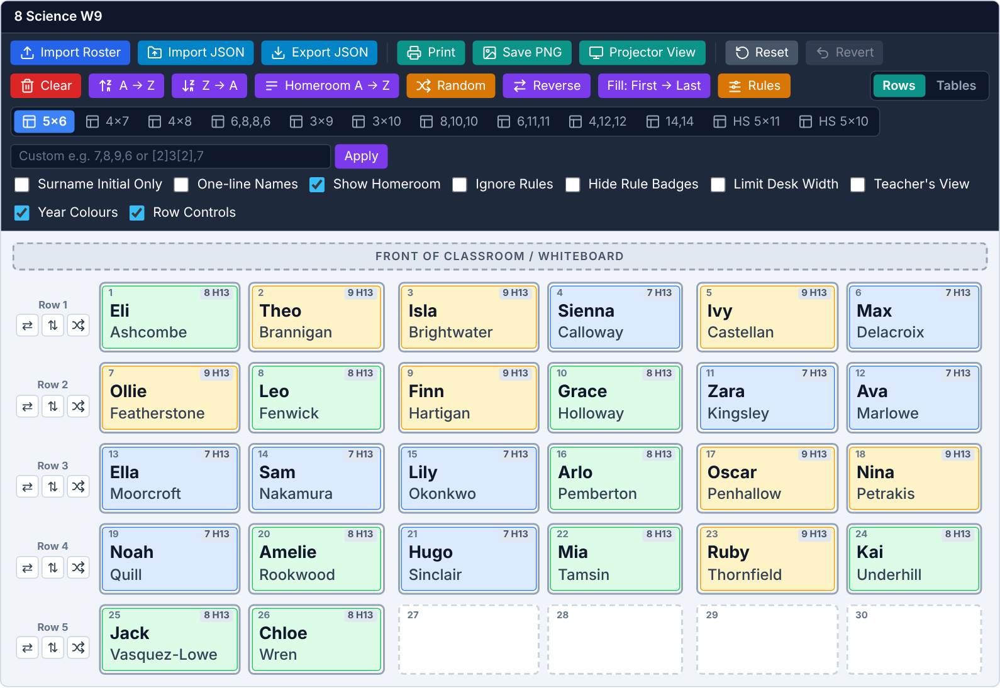
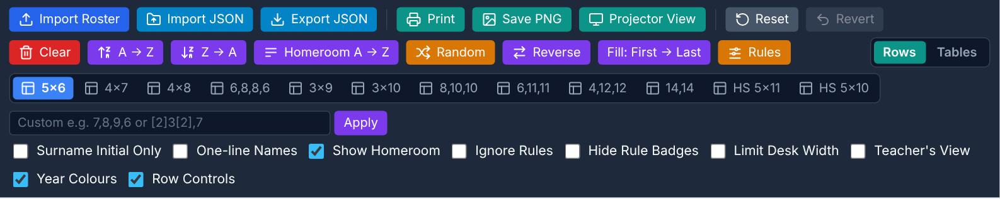
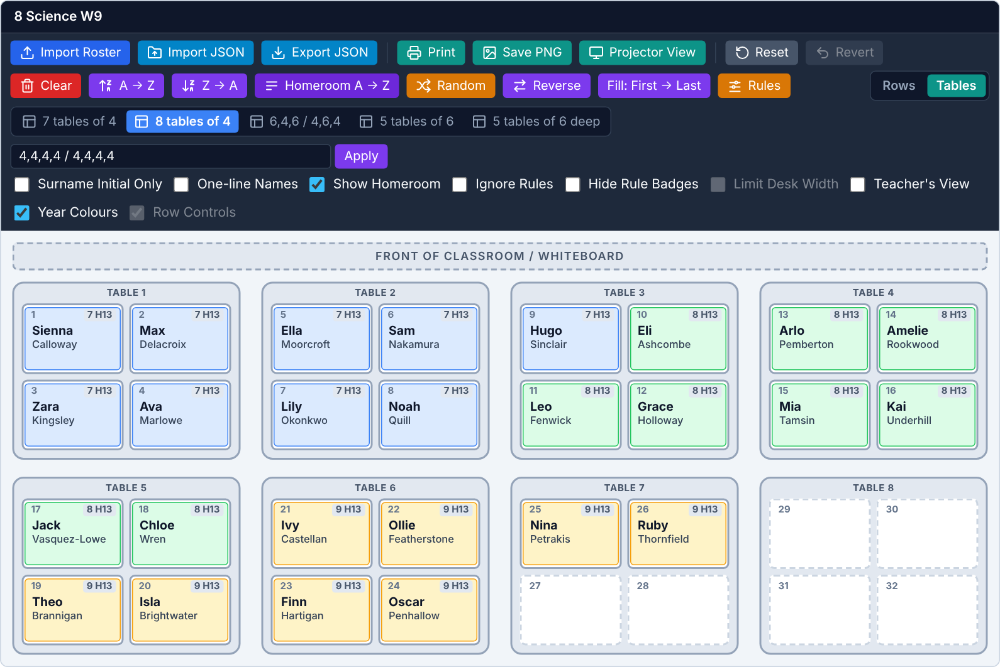

=======================
Seating Plan user guide
=======================

The seating plan lets you load a class list, set up the room, add seating
rules and arrange students on desks, then print it or show it on the
projector. Everything happens in your browser: student names are never sent
anywhere, and the plan is saved on this computer as you work.

This guide shows how to use the seating plan and get the most out of it.
Technical details for whoever runs the website are in
:doc:`/info/seatingplan_dev`.

All the pictures in this guide use made-up students.

   A class seated A → Z in five rows of six desks. Each desk shows its number
   (top left), the student's year and homeroom (**7 H13**, **8 H13**,
   **9 H13**, top right) and is coloured by year level.

----

Quick start
-----------

#. Press **Import Roster** and choose your class's Excel or CSV export.
#. Click the title and type the class name, e.g. *8 Science W9*.
#. Pick a layout that matches the room, or type your own.
#. Press **Rules** to add any seating rules.
#. Press **A → Z**, **Random** or another sort, then drag students to fine-tune.
#. **Print** or **Save PNG**, or press **Projector View** to show it to the class.
#. Press **Export JSON** to keep a backup copy.

Importing a class list
----------------------

**Import Roster** reads an Excel file (``.xlsx`` or ``.xls``) or a CSV file.
The first row must be a header row with these columns (in any order, any
capitals):

* **Preferred** or **First Name**: the name shown on the desk
* **Surname** or **Last Name**
* **Homeroom** (optional), also read from **TG**, **Tutor Group** or
  **House**: shown as a small badge in the desk's top-right corner, e.g.
  *Hughes 13* shows as **H13**
* **Year** or **Year Level** (optional): put in front of the homeroom, so a
  Year 7 student in Hughes 13 shows as **7 H13**. "Year 7" written in the
  homeroom itself (*Year 7 in Hughes 13*) works too.

Other columns are ignored, so an export from School Class Lists works as it
is. The plan's title is taken from the file name (``8_Science_W9.xlsx``
becomes *8 Science W9*), and you can click it to change it.

Importing a new class list **removes the existing rules**, because they
belonged to the old students; you are asked to confirm first.

Adding more students
~~~~~~~~~~~~~~~~~~~~

**Import Roster** replaces the students already in the plan. To keep them and
add more (a late enrolment, or a second class sharing the room), use
**Add Students** instead, with a file in the same format:

* New students go to the **Unassigned** list. Drag them to desks, or press a
  sort button to re-seat everyone.
* Students already seated stay where they are, and the rules, locked desks and
  title are kept.
* Anyone already in the plan (same first name and surname, capitals don't
  matter) is not added twice. If the file gives them a different homeroom or
  TG, theirs is updated.

The title
---------

Click the dark title bar to type a new title, then press **Enter** or click
away. The title is saved, printed at the top of the page and used as the
suggested file name for **Export JSON** and **Save PNG**.

The toolbar
-----------

The buttons are coloured by what they do:

* **Blue**: bring a class list in (**Import Roster**).
* **Lighter blue**: plan files (**Import JSON**, **Export JSON**).
* **Teal**: printing and showing (**Print**, **Save PNG**, **Projector View**).
* **Grey**: **Reset** and **Revert**.
* **Purple** and **amber**: arranging students (**A → Z**, **Random**,
  **Rules** …), and **red** for **Clear**.

   The toolbar.

Top row: files and output
~~~~~~~~~~~~~~~~~~~~~~~~~

**Import Roster**
   Load a class list, replacing the current one (see `Importing a class list`_).

**Add Students**
   Add students from another class list without removing anyone (see
   `Adding more students`_).

**Import JSON**
   Load a plan saved with **Export JSON**: title, class list, rules, layout,
   seats and display options all come back exactly as they were.

**Export JSON**
   Save the whole plan as a file. In Chrome and Edge you choose the folder
   and name; other browsers ask for a name and save to Downloads.

**Print**
   Print this plan on one landscape page (see `Printing`_).

**Save PNG**
   Save the printable plan as a picture, ready to paste into an email, a
   slide or relief-teacher notes (see `Saving as a picture`_).

**Projector View**
   Show only the whiteboard and desks, full screen, in large text. Press
   **Esc** or **✕ Exit projector view** to return.

**Reset**
   Go back to the plan as it was first set up on the page (usually empty),
   removing your class list, rules and changes from this browser. You are
   asked to confirm.

**Revert**
   Go back to the last file you imported or exported, undoing everything
   since. This is greyed out until you have imported or exported something. After an
   **Import Roster**, it returns the class to the file's original order.

Second row: arranging students
~~~~~~~~~~~~~~~~~~~~~~~~~~~~~~

**Clear**
   Move every student off the desks into the **Unassigned** list, ready to
   drag them into place by hand.

**A → Z** / **Z → A**
   Seat students in surname order.

**TG A → Z**
   Group students by tutor group (TG, the Homeroom column), then by surname
   within each group.

**Random**
   Seat students in a random order. Press again for a new arrangement.

**Reverse**
   Reverse the current order, so the student at the first desk moves to the
   last desk and so on.

**Fill: First → Last** / **Fill: Last → First**
   Choose whether seating starts at desk 1 (front left) or at the last desk
   (back right). Fill from the back when the class is smaller than the room
   and you want the front rows empty.

**Rules**
   Open the seating rules (see `Seating rules`_).

**Lock Seats**
   Lock desks that are out of use, so no one is seated there (see
   `Locked desks`_).

**Rows** / **Tables**
   Switch between rows of desks and groups of tables (see `Layouts`_).

Every sort follows the rules first, then fills the remaining desks in the
chosen order. Desks are numbered in the order they are filled.

Third row: layouts
~~~~~~~~~~~~~~~~~~

Press a preset button, or type a layout in the **Custom** box and press
**Apply** (or **Enter**). The current layout is always shown in the box, so
you can tweak it. Changing the layout re-seats everyone using the last sort.

Fourth row: display options
~~~~~~~~~~~~~~~~~~~~~~~~~~~

**Surname Initial Only**
   Show *Alex S.* instead of *Alex Smith*.

**One-line Names**
   First name and surname side by side, with shorter desks. Useful for large
   classes.

**Show Homeroom**
   Show or hide the year and homeroom badge in each desk's top-right corner.

**Year Colours**
   Colour each desk by the student's year level, the same colours as the
   locker tool: Year 7 blue, Year 8 green, Year 9 amber, Year 10 purple,
   Year 11 pink, Year 12 teal. A rule colour (see `Badges and colours`_)
   comes first. Only shown when students have a year level.

**Ignore Rules**
   Arrange students without applying any rules (the rules are kept, just not
   used).

**Hide Rule Badges**
   Hide the rule badges and group colours, e.g. when the plan is on the
   projector and students shouldn't see who has a rule.

**Limit Desk Width**
   Rows with fewer than 6 desks keep the width of a 6-desk row instead of
   stretching across the room. Rows mode only.

**Teacher's View**
   Show the room from the front: whiteboard at the bottom, rows reversed and
   left and right swapped. It is also used when printing.

**Row Controls**
   Show or hide the buttons beside each row (see `Moving whole rows`_). Rows
   mode only.

All display options are saved with the plan.

Layouts
-------

Rows of desks
~~~~~~~~~~~~~

Type the number of desks in each row, **front row first**, separated by
commas:

* ``7,8,9,6``: rows of 7, 8, 9 and 6 desks
* ``5x6``: 5 rows of 6 desks

Put empty floor space in square brackets, counted in desk widths:

* ``3[1]3``: 3 desks, an aisle, 3 desks
* ``[2]3[2]``: a row of 3 desks centred, with 2 spaces each side
* ``1[6]1, 1[6]1, 8``: a horseshoe

Limits: up to 12 rows, each with 1–20 desks and at most 24 places wide (desks plus
spaces). Desks either side of a space are not counted as next to each other.

Tables
~~~~~~

In **Tables** mode, type the seats at each table, commas between tables and
``/`` between rows of tables, front row first:

* ``4``: a table of 4 (2 × 2)
* ``6``: a table of 6, 3 wide and 2 deep
* ``6d``: a table of 6, 2 wide and 3 deep

| For example:
| ``6,4,6 / 4,6,4`` means tables of 6, 4 and 6 then tables of 4, 6 and 4.
| ``2x3`` means 2 rows of 3 tables of 4.
| ``2x3 6`` uses 2 rows of 3 tables of 6.
| Limits: up to 8 rows of 8 tables.

Rows and tables each keep their own layout, so you can switch between them
without losing either.

   The same class in **Tables** mode (8 tables of 4), seated with
   **TG A → Z**, so each year (and colour) sits together.

Moving students by hand
-----------------------

* **Drag** a student onto an empty desk to move them there.
* Drag onto a desk that already has a student to **swap** the two.
* When the **Unassigned** list is showing (students without a desk), drag
  students into it or out of it.

Dragging is not limited by the rules, but a desk turns **red** if the student
there breaks one, so you can see at a glance what needs fixing.

Moving whole rows
-----------------

In **Rows** mode, each row has a label (*Row 1* is the front row) and three
buttons on its left:

* **⇄ Flip** reverses the students in that row, so the student at one end
  moves to the other end.
* **⇅ Swap** exchanges two rows. Press **⇅** on the first row (it gets an
  orange dashed outline), then **⇅** on the row to swap it with, e.g. row 1
  then row 3. To cancel, press **⇅** on the same row again, or press **Esc**.
* **Shuffle** (the crossed-arrows button) mixes up the students in that row
  only. They swap among the desks they already use, so empty desks stay
  empty, and the rest of the room is untouched. It looks for an order that
  breaks no rules, so keep-together groups stay side by side. Press it again
  for a different order.

Only the students move; the desks and the layout stay the same. When
swapping, each student takes the same desk position in the other row, so an
empty desk stays where it was. If the two rows have different numbers of
desks, students who don't fit go to a free desk in the longer row, or to
**Unassigned** if there is none (a message says so).

Flipping and swapping do not check the rules: a desk turns red if a student
there now breaks one (e.g. a *Left side* student who is now on the right).

Untick **Row Controls** to hide all three buttons. They never appear in
**Projector View**, in **Tables** mode or on printouts.

Locked desks
------------

Lock a desk that is broken, out of use or kept free, and no student will be
seated there.

* **Right-click** a desk to lock it, and right-click it again to unlock it.
* Or press **Lock Seats**, click the desks to lock or unlock, then press
  **Done Locking** (or :kbd:`Esc`). This also works on a touch screen.

A locked desk is shaded with stripes and labelled *Locked*, on screen and on the
printout. If a student was sitting there, they move to the **Unassigned** list.
Sorting, **Random**, the row buttons and dragging all skip locked desks.

A locked desk does count as the empty seat beside a student who has the
*Empty seat beside* rule.

Each layout keeps its own locked desks, so switching to another layout and back
brings them back. They are saved in the browser and in **Export JSON** files.
**Reset** goes back to the desks locked on the page.

Seating rules
-------------

Press **Rules**, choose a rule from the drop-down, then tick the students it
applies to. Changes are saved straight away; press **Done** to close.

**⬆ Front row** / **⬇ Back row**
   Ticked students sit in the front (or back) row.

**⬅ Left side** / **➡ Right side**
   Ticked students sit at the left (or right) end of a row. Left and right
   are the *students'* left and right, facing the whiteboard.

**🪑 Empty seat beside**
   Ticked students get an empty desk next to them. That desk is kept free, so
   it counts towards the room's capacity.

**🔗 Keep together**
   Press **+ New group** and tick 2–4 students who should sit side by side.
   A pair is placed on a shared pair of desks (desks 1–2, 3–4 …) where
   possible; 3 sit on neighbouring desks; 4 fill two pairs of desks. A
   student can only be in one keep-together group.

**⚠️ Keep apart**
   Press **+ New group** and tick 2 or more students. No two of them sit
   next to each other, including diagonally. A student can be in several
   keep-apart groups.

Use **Edit** or the bin to change or delete a group, and **Clear all** to
remove a one-student rule from everyone. Students who can't be added (e.g.
someone in the front row being put with someone in the back row) are greyed
out with the reason beside their name.

In **Tables** mode, the rules apply to tables instead: *front row* means a
table in the front row of tables, *keep together* means the same table (up
to the size of the largest table), and *keep apart* means different tables.

When not every rule can be met
~~~~~~~~~~~~~~~~~~~~~~~~~~~~~~

If the room can't satisfy every rule at once (too many front-row students,
say), the plan keeps as many as it can, giving priority to rules added
earlier. A message lists the rules that were left out, and the desks
breaking them are shown in red.

Badges and colours
------------------

Each student card shows small badges:

* **7 H13** (top-right corner): year and homeroom (hide with **Show Homeroom**)
* **⬆ Front**, **⬇ Back**, **⬅ Left**, **➡ Right**, **🪑 Empty**: the
  student has that rule; the card is blue
* **🔗 1**, **🔗 2** …: the student's keep-together group. The card is tinted
  in the group's colour, so everyone in a group shares a colour.
* **⚠️ 1**, **⚠️ 2** …: a keep-apart group, shown as a dashed badge in the
  group's colour on an orange card. Students with the same badge must not
  sit next to each other.

Group numbers and colours match the groups listed in **Rules**.
Keep-together and keep-apart groups use different colours, so **🔗 1** and
**⚠️ 1** never look alike. A **red** desk means the student there is
breaking a rule.

**Hide Rule Badges** hides all rule badges and group colours but keeps the
homeroom badge.

Each desk is laid out like a locker in the locker tool: the desk number in
the top-left corner, the year and homeroom badge (**7 H13**) in the top-right
corner, then the first name in bold and the surname underneath. With
**Year Colours** ticked, desks without a rule colour are coloured by year
level.

Printing
--------

**Print** opens a print-ready copy on one landscape page: the title,
whiteboard and desks with students' names (and homerooms, if shown), exactly
as they are seated. Rule badges, group colours, red highlights and row buttons are always
left off. **One-line Names** and **Teacher's View** are used if they are on.
Choose **Save as PDF** in the print box to keep a PDF.

Saving as a picture
~~~~~~~~~~~~~~~~~~~

**Save PNG** saves the same printable layout as a PNG image. It shows
exactly what **Print** would: no rule badges, group colours or row buttons,
with **One-line Names** and **Teacher's View** applied if they are on. The
image is high-resolution, so it stays sharp when printed or shown on a
screen.

You choose where it goes:

* **Chrome and Edge:** a **Save As** box opens, so you can pick the folder and
  file name. The name starts as the plan's title, e.g.
  ``8_science_w9.png``. The picture is ready a moment after you press
  **Save**; the message bar says when.
* **Other browsers:** you are asked for a file name, and the picture is saved
  to your Downloads folder (or wherever your browser saves downloads).

The first time you press **Save PNG**, the page downloads a small image
library, so an internet connection is needed. The picture itself is made in
your browser: student names are not sent anywhere.

Getting the most out of it
--------------------------

**Set each class up once.** Import the class list, name the plan, choose the
layout, add your rules, then press **Export JSON** and keep the file. After that,
changing the seating takes seconds.

**Add rules first, then sort.** Every sort follows the rules, so add *Front row*,
*Keep apart* and so on before pressing **A → Z** or **Random**. Then fine-tune by
dragging; red desks show anything you need to fix.

**Use as few rules as you need.** Each rule narrows the choices. With many rules
in a small room the plan may not be able to meet them all, and it tells you
which it left out. Keep the essentials (support needs, students who must be
apart) and handle the rest by hand.

**Match the real room.** Use square brackets for aisles and gaps (``3[1]3``) so
"next to" means next to in the real room. Students across an aisle are not
counted as neighbours.

**Fill from the back for small classes.** **Fill: Last → First** leaves the front
rows empty, or use it with *Front row* rules so the students who need to be
close still are.

**Freshen up without starting again.** Use a row's **Shuffle** button to mix up
one row, **⇅ Swap** to move a whole row forward, or **⇄ Flip** to swap the ends
of a row, without touching the rest of the room.

**Two layouts for one class.** Rows and Tables keep their own layouts, so the
same class can switch between test seating (rows) and group work (tables) with
one click. For a different room, keep a second plan (see
:doc:`/info/seatingplans_info`).

**Project it, then print it.** Tick **Hide Rule Badges** before **Projector
View** so students don't see who has a rule. Tick **Teacher's View** before
printing to get a copy that matches what you see from the front.

**Share it as a picture.** **Save PNG** gives an image you can paste into an
email to a relief teacher, a slide for the first lesson, or your class notes.
It is often quicker than printing.

**Keep a copy before experimenting.** Press **Export JSON** first; **Revert**
brings the saved plan straight back.

Saving and privacy
------------------

* **Saved automatically.** Every change is saved straight away in this
  browser. Close the page and it reopens exactly as you left it, with every
  student on the same desk.
* **Only in this browser on this computer.** The plan is not sent to any
  server and is not copied to your other computers or browsers. It is lost
  if the browser's site data is cleared, and isn't kept at all in a private
  or incognito window.
* **Back up with Export JSON**, and use **Import JSON** to move the plan to
  another computer or browser.
* **Shared computers:** anyone using the same computer sign-in and browser
  can open the page and see the plan. Press **Reset** before you leave a
  shared computer.
* **Exported files contain student names.** Store them where you keep other
  class lists, not on shared or public drives.